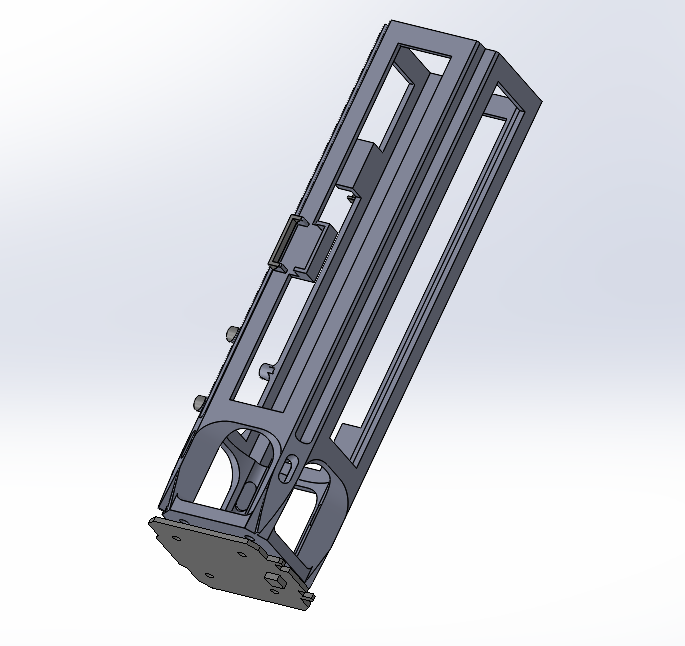
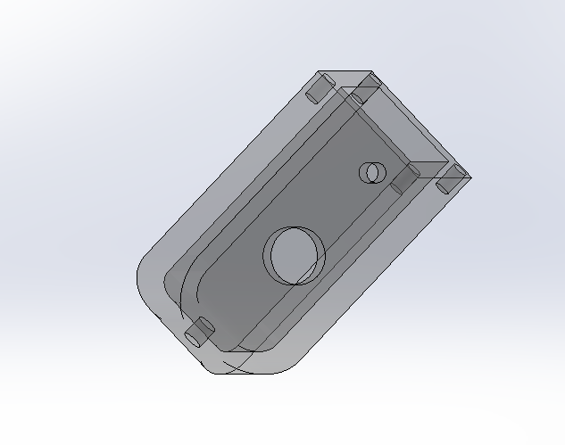
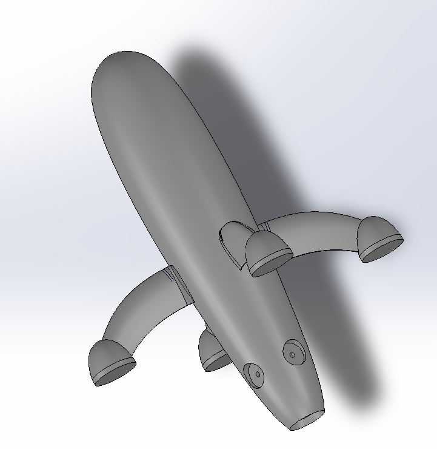
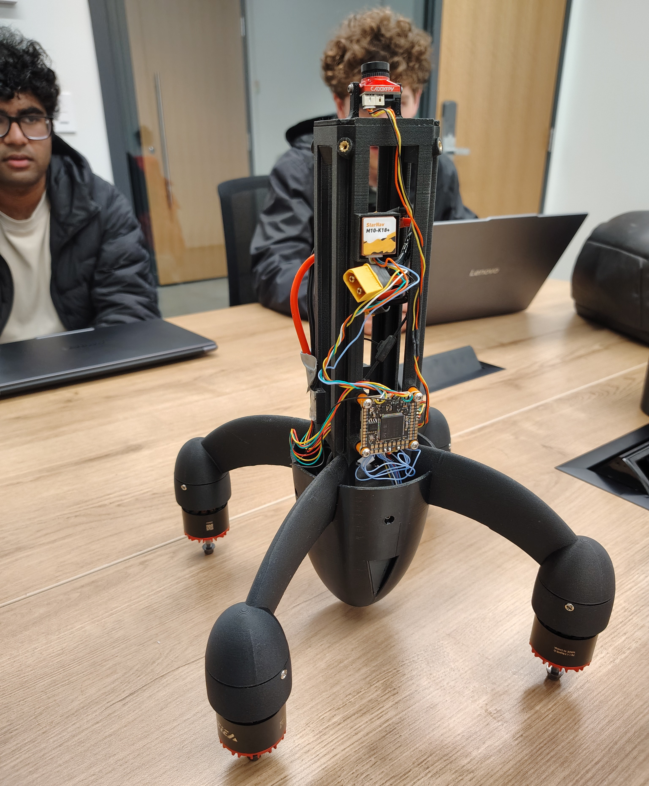

I collaborated with a team of seven in order to try and create the world's fastest quadcopter drone. We developed the outer shell, the internal frame to hold the components, and a water box designed to cool the drone in flight. Designed in Solidworks, the drone is 3D printed with a carbon fiber frame. The max speed of the drone is over 400 kmph.

We started on the project in October 2025 by first doing some baseline calculations in order to determine what parts to order for our drone. This was mainly for the battery and the electronic speed controller (ESC), as at high speeds the ESC draws lots of power and can be prone to overheating, so we needed to make sure we had a battery that would be able to support the ESC with enough power. We also needed to make sure we used the correct motor which could generate enough thrust to go at high speeds.

<object data="/assets/other/Assumptions and Calculations.pdf" type="application/pdf" width="100%" height="700px">
    <embed src="/assets/other/Assumptions and Calculations.pdf">
        
This browser does not support PDFs. Please download the PDF to view it: <a href="/assets/other/Assumptions and Calculations.pdf">Download PDF</a>.

    </embed>
</object>

Using these calculations we chose our parts and while we waited for them to ship for us, we designed the frame and the shell of the drone. To do this we split into three teams. I led the Power Systems team where we had to design a mounting system for all the components needed for a drone in the inside of the drone, including the camera, GPS, Flight Control, and the ESC and battery. To combat the issue of the ESC overheating, we had a Cooling team, where they designed a water box to be in contact with the ESC with a fan inside, to cool the ESC while in flight. The third team was the Aerodynamics team which designed the shell to go around the frame and be as aerodynamically efficient as possible. Though we separated into three teams, we all worked with each other on all the aspects of the drone.

As part of the power systems team we designed a frame for the inside of the drone in order to hold all the internal components of the drone securely while flying at high speeds.

As part of our considerations we had to make sure the frame had mounts for the ESC, video transmitter (VTX), camera, receiver, and GPS, as well as securely housing the battery on the inside. We also had to make sure the wiring would be reasonable, which is why we designed the channels along the edges of the frame. The ESC would sit on the bottom of the frame where the cooling system is located:

This is a water block, CNC machined out of aluminum which would have a copper plate on top to contact the ESC. There would be a small fan to circulate the water in the hole on the side of the water block. Between each flight we would refill the water block up with cold water to make sure the ESC was at an optimal temperature while flying.

Finally our shell was designed to house the frame and the cooling system and still be as aerodynamic as possible. We manufactured the arms of the shell with channels through them for wires to attach to the motors which would screw on to the ends of the arms. The shell went through a few iterations through CFD testing and changing of priorities before we landed on this design.

We 3D printed the frame of the drone using a carbon fiber infused filament for structural integrity, while the shell was made out of PLA.
