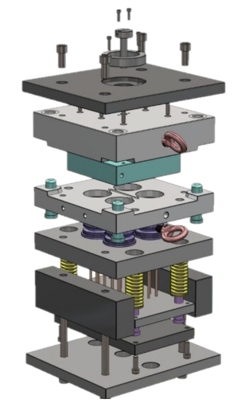
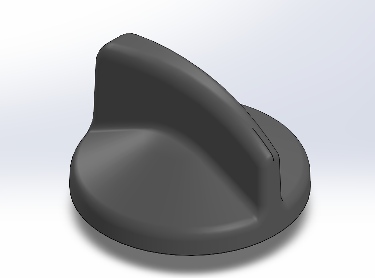
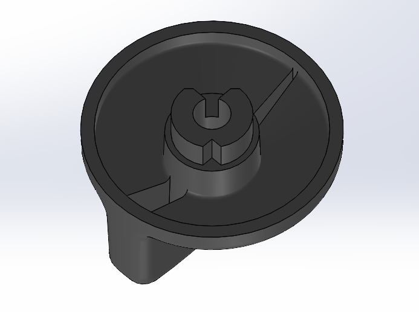

I designed a mold using Solidworks in order to practice using the hole wizard and learn more about the process of injection molding. I designed the cavity and core for a plastic mold, including an insert to facilitate removal because the knob had overhangs. The mold has a fully functional cooling system as well as a system of gates and runners to distribute plastic to the four molds.

I started by first modeling the knob, which was a fairly simple task. This was an approximation of the knob in real life, and I was not too focused on making the dimensions exactly accurate, because I was more focused on the mold.

